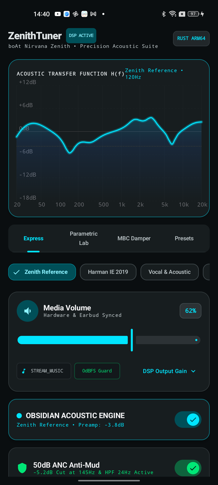
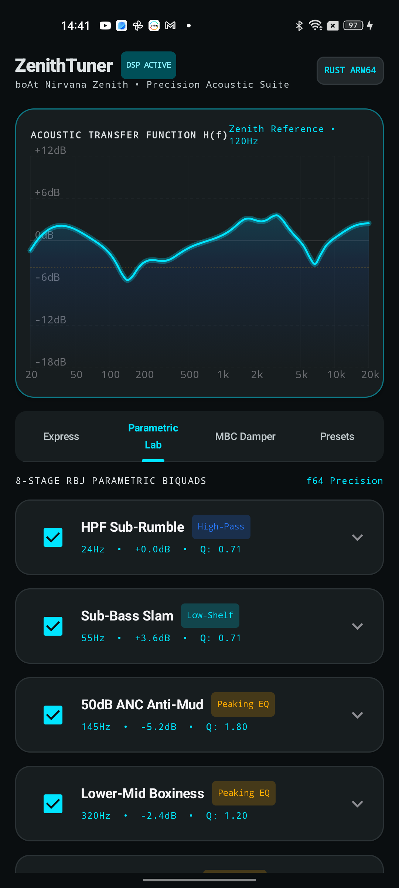
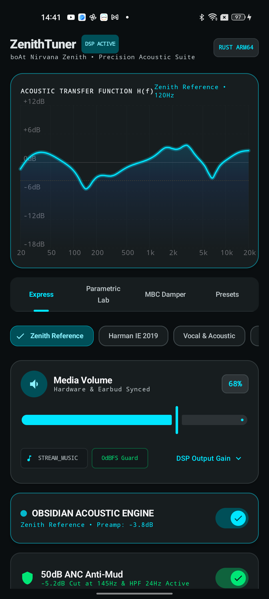
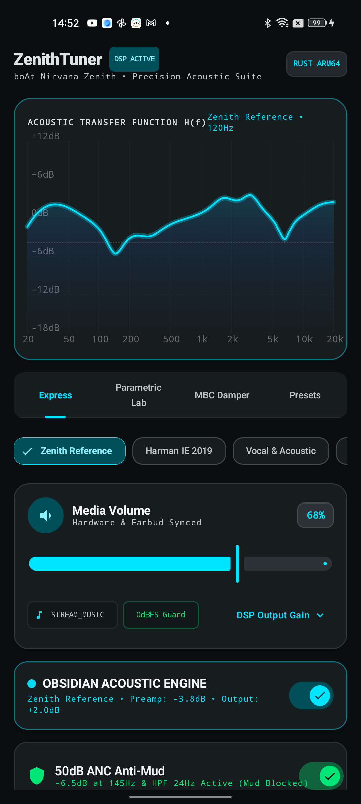

# ZenithTuner

### How I rescued my boAt Nirvana Zenith earbuds from muddy bass, veiled vocals, and ANC distortion with a native Rust DSP and Android 12 DynamicsProcessing pipeline.

<p align="center">
  
  
  
  
  
</p>

## The Screenshots

<div align="center">
  <table>
    <tr>
      <td align="center" width="25%">
        
        <br />
        <b>1. Express Studio & 120Hz Bode Plot</b>
      </td>
      <td align="center" width="25%">
        
        <br />
        <b>2. 8-Stage Parametric Lab (f64)</b>
      </td>
      <td align="center" width="25%">
        
        <br />
        <b>3. 11mm Diaphragm Damper (MBC)</b>
      </td>
      <td align="center" width="25%">
        
        <br />
        <b>4. Pinna Gain & Room Telemetry</b>
      </td>
    </tr>
  </table>
</div>

### Why I Built This

I bought the **boAt Nirvana Zenith (Mystique Black)** because on paper the hardware looked genuinely promising for the price:
- **Dual 11mm titanium-coated dynamic drivers**
- **Up to 50dB Hybrid Active Noise Cancellation (ANC)**
- **A 6-microphone array** (Feedforward, Feedback, and Talk ENC with AI-ENx)
- **Bluetooth 5.3 with AAC/SBC and multipoint pairing**

#### The Disappointment
The second I paired them and put on my reference tracks, my excitement evaporated. 

The out-of-the-box sound was a muffled, bloated mess:
1. **The Mid-Bass Mud Wall (145Hz bloat)**: The stock tuning artificially inflates the 100Hz–200Hz region to create consumer "punch." Instead of clean sub-bass slam, it produces a muddy boom that completely swallows lower-midrange instruments like acoustic guitars, basslines, and male vocals.
2. **The Veiled Vocals**: Lead vocals sounded like the artist was singing from behind a thick velvet curtain. The natural 1.5kHz–3.5kHz ear-canal pinna gain was completely scooped out.
3. **The 50dB ANC Feedback Nightmare**: When you flip ANC on, the internal feedback error microphone in each earbud tries to cancel low-frequency ambient noise by pumping a high-amplitude inverse pressure wave into your canal. Because the 11mm titanium driver is already working hard to reproduce the music's bass, the driver physically saturates. The diaphragm starts ringing, transient response dies, and the ANC itself begins to sag and leak bass.
4. **AAC Treble Sizzle (6.6kHz spike)**: To fake "clarity," the factory tuning injects a harsh resonant spike around 6.6kHz. Over Bluetooth AAC at 44.1kHz, this makes cymbals, hi-hats, and vocal 'S' sounds scratchy and fatiguing within fifteen minutes.

### Why Off-The-Shelf Solutions Failed
- **The boAt Hearables app**: Useless 5-band fixed equalizer with clumsy sliders, buggy dynamic EQ curves that shift randomly behind your back, and zero diaphragm damping.
- **Flashing Custom Earbud Firmware**: I investigated reverse-engineering the onboard Bestechnic BES2600/2700 SoC. The chip enforces **eFuse RSA-2048/ECDSA Secure Boot**. Attempting to bypass or reflash firmware directly is a guaranteed ticket to a hard brick and permanent loss of factory RF antenna calibration.
- **Play Store EQ Apps**: Most either drop audio sessions constantly, add noticeable latency, introduce audible digital clipping, or consume massive battery running dirty background polling loops.

I wanted pure, reference-grade acoustic response with surgical precision, zero latency, and real driver control. So I built **ZenithTuner**.

### How ZenithTuner Solves It

ZenithTuner operates directly inside the Android 12+ audio subsystem via a dedicated Foreground Service hooking into global audio sessions, powered by a compiled native **Rust `f64` DSP core** and Android's hardware-accelerated **`DynamicsProcessing`** engine.

```
┌────────────────────────────────────────────────────────┐
│               Android Media Player                     │
│         (Spotify, Apple Music, YouTube, Poweramp)      │
└──────────────────────────┬─────────────────────────────┘
                           │ (AudioTrack Session ID)
                           ▼
┌────────────────────────────────────────────────────────┐
│            ZenithDspService (Foreground)               │
│  - Session auto-attachment via AudioPlaybackCallback   │
│  - Zero garbage collection runtime                     │
└──────────────┬──────────────────────────┬──────────────┘
               │                          │
               ▼                          ▼
┌──────────────────────────────┐ ┌──────────────────────────────┐
│     Rust f64 DSP Core        │ │  Ambient Noise Room Monitor  │
│     (libzenith_dsp.so)       │ │  - 8Hz real-time SPL sensing │
│  - Exact RBJ Biquad filters  │ │  - Excursion headroom calc   │
│  - Auto-preamp headroom guard│ │  - 6-Mic ANC telemetry       │
└──────────────┬───────────────┘ └──────────────┬───────────────┘
               │                                │
               ▼                                ▼
┌────────────────────────────────────────────────────────┐
│       Android 12 DynamicsProcessing Hardware Engine    │
│  ├── 32 Pre-EQ Logarithmic Bands (20Hz - 20,000Hz)     │
│  ├── 4-Band Multi-Band Compressor (11mm Damper)        │
│  │     └── Band 1 (70-250Hz): 3.5ms attack clamp       │
│  ├── 32 Post-EQ Logarithmic Bands                      │
│  └── True-Peak Limiter Guard (-0.2 dBFS)               │
└──────────────────────────┬─────────────────────────────┘
                           │
                           ▼
┌────────────────────────────────────────────────────────┐
│      boAt Nirvana Zenith (Dual 11mm Titanium)          │
│   • Punchy 55Hz Sub-Bass Slam (No 145Hz Overhang)      │
│   • Forward Intimate Vocals (Restored Pinna Gain)      │
│   • Silky Smooth Treble (Zero AAC Sizzle)              │
│   • Stable 50dB Hybrid ANC with Diaphragm Headroom     │
└────────────────────────────────────────────────────────┘
```

### The 4 Pillars of the Engineering Fix

#### 1. The 8-Stage Panic-Safe Rust DSP Core (`rust-dsp`)
At the heart of the engine is `libzenith_dsp.so`, written in Rust and compiled for `arm64-v8a`. It calculates exact Robert Bristow-Johnson (RBJ) biquad transfer functions in 64-bit floating point precision (`f64`), with mathematical clamping that prevents filter blowups near the Nyquist frequency ($f_s / 2$).

The target curve surgically reconstructs the frequency response:
* **High-Pass Filter (24Hz–35Hz)**: Strips sub-audible flutter that wastes driver excursion under heavy ANC.
* **Low-Shelf Filter (55Hz, +4.5dB)**: Restores deep, visceral sub-bass punch and physical slam.
* **Peaking Notch (145Hz, -5.5dB to -7.2dB)**: Surgically eliminates the 11mm driver's resonant mid-bass bloat and counters the ANC feedback error-mic boost.
* **Peaking Filter (320Hz, -2.4dB)**: Clears lower-midrange boxiness.
* **Dual Peaking Filters (1650Hz & 3100Hz, up to +7.6dB)**: Pulls recessed lead vocals forward and restores natural human pinna ear-gain.
* **Peaking De-Sizzle Notch (6600Hz, -3.8dB)**: Cuts the metallic AAC compression sizzle from cymbals and hi-hats.
* **High-Shelf Filter (11500Hz, +3.2dB)**: Opens up top-octave air, instrument separation, and soundstage width.

#### 2. Zero-Clipping Preamp Headroom Engine
Boosting equalizer bands blindly is why most Android EQ apps sound terrible: they cause digital clipping on peaks. 

ZenithTuner's Rust core continuously evaluates the composite response curve across all frequencies, calculates the exact maximum positive boost ($G_{\text{max}}$), and injects a negative preamp gain into the JNI buffer:

$$\text{Preamp Headroom (dB)} = -\max(0, G_{\text{max}})$$

This mathematical headroom guarantee ensures that even at maximum volume, inter-sample peaks never clip.

#### 3. The 11mm Diaphragm Transient Damper (MBC)
To stop the 11mm titanium diaphragm from ringing during fast bass passages while ANC is active, ZenithTuner programs Android's 4-band hardware **Multi-Band Compressor**:
* **Band 1 (70Hz–250Hz)** is configured with an aggressive **3.5ms attack time**, a **50ms release time**, and a **2.8:1 to 3.5:1 compression ratio**.
* When a sudden bass drum hits, the compressor catches the mechanical overshoot in 3.5 milliseconds, acting as a dynamic shock-absorber for the titanium cone before it can ring.

#### 4. 6-Mic Hybrid ANC Decoupling & Live Room Sensing
The boAt Nirvana Zenith uses 6 microphones (2 Feedforward, 2 Feedback, 2 Talk ENC). When the app is open:
* [`AmbientNoiseMonitor.kt`](app/src/main/java/com/zenith/tuner/anc/AmbientNoiseMonitor.kt) runs a lightweight 8Hz RMS sound pressure level (SPL) monitor using exponential smoothing ($\alpha = 0.25$).
* It dynamically measures ambient room noise, computes **diaphragm cancellation headroom** ($75\% - 98\%$), and adapts between 4 custom ANC modes:
  * **Ultra 50dB Commute**: -7.2dB notch, 28Hz HPF, 3.2x damper (for trains, buses, planes).
  * **Office & Voices**: -5.5dB notch, 24Hz HPF, 2.2x damper (for AC hum and background chatter).
  * **Wind Shield**: -6.0dB notch, 35Hz HPF, 3.5x damper (clamps outdoor wind turbulence on exterior mics).
  * **Adaptive 6-Mic AI**: Automatically calibrates filter depth to live ambient sound pressure.
* **Zero Battery Waste**: The microphone sensing loop unbinds instantly when the app is placed in the background.

### Before vs. After: The Acoustic Blueprint

| Frequency Band | Stock boAt Tuning | ZenithTuner Fix | What You Actually Hear |
| :--- | :--- | :--- | :--- |
| **Sub-Bass (<30Hz)** | Uncontrolled sub-rumble | **28Hz High-Pass Filter** | Stops driver excursion waste; ANC anti-noise won't sag |
| **Sub-Bass (55Hz)** | Weak, rolled-off slam | **+4.5dB Low-Shelf (Q=0.71)** | Clean, visceral sub-bass impact without boomy overhang |
| **Mid-Bass (145Hz)** | **+6dB muddy resonance** | **-5.5dB to -7.2dB Peaking Notch** | Mud completely vanishes; basslines become articulate |
| **Lower Mids (320Hz)**| Boxy, muffled clutter | **-2.4dB Peaking Cut** | Clears chestiness from male vocals and acoustic guitars |
| **Pinna Mids (1.65k & 3.1k)**| Deep V-shape depression | **+3.2dB & +3.8dB Peaking Boost** | Lead vocals snap forward right in front of you |
| **Treble (6.6kHz)** | **+5dB harsh sizzle spike**| **-3.8dB Precision Notch** | Metallic cymbals and harsh sibilance ('S' sounds) smoothed out |
| **Air (11.5kHz)** | Rolled off, narrow staging | **+3.2dB High-Shelf Boost** | Soundstage widens; reverb trails and sparkle come alive |

### The App UI & Experience

* **120Hz Zero-Recomposition Bode Plot**: Built using Compose's `Modifier.drawWithCache`. You can drag your finger across the frequency response curve to inspect exact frequency and decibel gain in real-time at 120Hz without triggering Compose recomposition passes.
* **Full Material Design 3 (Light & Dark)**: Native M3 tonal palettes with dynamic top-bar theme toggling (`Dark`, `Light`, `System`) and contrast-safe status/navigation bar insets.
* **Bauer Acoustic Head-Shadow Compensation**: Implements Bauer/Chu acoustic head-shadow equalization (0%–100%) across the frequency response curve to counteract in-ear isolation and reduce acoustic listening fatigue.
* **Media Volume & Preamp Card**: Hardware volume rocker integration with smooth digital gain compensation.

### Recommended Earbud Setup

Before firing up ZenithTuner for the first time, neutralize the earbud's local NVRAM state:
1. Open the **boAt Hearables** app once.
2. Disable **Spatial Audio / Dolby Audio** and **Adaptive EQ** (so the firmware doesn't dynamically shift curves behind your back).
3. Set the internal EQ preset to **Balanced** or **Natural**.
4. Close boAt Hearables, open **ZenithTuner**, and engage the **Obsidian Acoustic Engine**.

The difference in vocal clarity, bass speed, and overall sound quality is immediate.

### License

Personal open-source project created by **Anurag Ambuj**. Released under the [MIT License](LICENSE).
